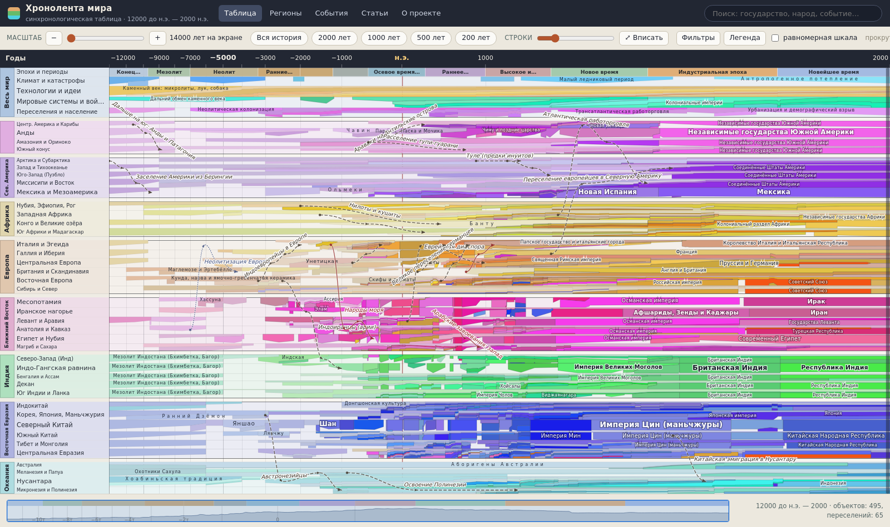

# Хронолента мира — интерактивная синхронологическая таблица

Многостраничный статический сайт для изучения всемирной истории.
Главная страница — интерактивная синхронологическая таблица в духе классических
«карт времени»: по вертикали регионы мира (сверху — общемировой план «Весь мир»,
затем от Южной Америки до Океании), по горизонтали — время от появления ранних
австралопитеков около 4,2 млн лет назад до 2000 г. н.э. На поле нанесены виды и
линии гоминин, археологические культуры, народы, государства, миграции и события.
При открытии страницы сохраняется прежний диапазон 12000 г. до н.э. — 2000 г. н.э.;
древняя часть доступна прокруткой влево или кнопкой «Вся история».



Контент хранится в markdown-файлах (их удобно вести в **Obsidian**), сайт —
обычная статика без сборщиков и зависимостей, публикуется на **GitHub Pages**.

Главная страница (`index.html`) объединяет всё вместе: на широком экране **карта**
занимает левую половину верхнего ряда, **лента хронологии** — правую; общая
**шкала управления** расположена под ними на всю ширину, а **синхронологическая
таблица** — ниже. Высота таблицы определяется её содержимым, поэтому все дорожки
показаны без внутреннего ограничения по высоте; прокручивается сама страница.
Чистая таблица по-прежнему живёт на отдельной вкладке `table.html`.
Подробности — в разделе «Новая главная» ниже.

## Возможности главной страницы

* обзорный режим — вся шкала от ≈4,2 млн лет назад до 2000 г. н.э.; на главной все 45 дорожек таблицы помещаются по высоте содержимого без отдельной внутренней прокрутки;
* управление как в карте: прокрутка колесом или двумя пальцами по тачпаду двигает
  полотно по вертикали и горизонтали, **щипок тачпада** либо **Ctrl/⌘ + колесо**
  растягивает шкалу времени (от обзора до 100–200 лет на экране); есть слайдер
  масштаба и пресеты «500 лет», «1000 лет», …;
* толщина ленты у государств отражает условную долю суб-региона; у гоминин и
  доисторических культур это графический акцент, а не оценка населения или точной границы ареала;
* народы и культуры подписаны простым текстом, государства и цивилизационные
  области — в рамке (как на плакате-образце);
* всплывающая подсказка по наведению и подробная статья по клику (панель справа);
* линии переселений и вторжений: тонкие стрелки, идущие строго по ходу времени
  (слева направо), с наконечниками на остановках маршрута и подписью вдоль линии;
  слишком крутые для текущего масштаба стрелки скрываются, чтобы не превращаться
  в вертикальные черты;
* 10 типов пиктограмм событий (битва, восстание, революция, технология, эпидемия…) —
  **слой событий сейчас выключен по умолчанию**, включается галочкой «события»
  в «Фильтрах»;
* фильтры по регионам, типам объектов, типам событий; слои (события, миграции, подписи);
* поиск с подсветкой найденного прямо на таблице;
* обзорная полоса-миникарта — над таблицей, между картой и планом; эпохи —
  первой строкой общемирового плана;
* по умолчанию включена нелинейная «плакатная» шкала; галочка переключает линейную проекцию и сохраняет текущие видимые даты.

## Что сейчас в базе

| | |
|---|---|
| Макро-регионы | 9 строк: «Весь мир» + 8 регионов (Юж. Америка → Океания) |
| Дорожки (суб-регионы) | 45 |
| Сущности (гоминины, культуры, народы, государства) | 529 — включая 20 видов/линий гоминин и 14 доисторических культур/сводных комплексов |
| События с пиктограммами | 203 |
| Линии миграций и распространения технологий | 73 |
| Эпохи | 16 (от ранних гоминин до новейшего времени) |

Строка **«Весь мир»** — общепланетарный план: эпохи, климат и катастрофы
(поздний дриас, 8.2 ka, Тамбора, Самалас), технологии и идеи, мировые системы
связей и войны (Шёлковый путь, Колумбов обмен, мировые войны), переселения
и рост населения.

## Новая главная: карта · лента · управление · таблица

Расположение блоков `index.html` на широком экране:

1. **Верхний ряд:** слева — **карта мира** (половина ширины), справа — **лента
   хронологии**. Карта на MapLibre GL показывает исторические империи и
   современные границы; лента выводит события выбранной даты и по три ближайших
   события слева и справа — независимо от видимого диапазона таблицы. Щелчок
   по боковой карточке только выбирает её дату; подробности открываются щелчком
   по событию в центре. Стрелки **‹ ›** (или свайп) переключают к соседнему году
   события; события одной даты показываются вместе.
2. **Шкала управления** — сразу под картой и лентой, на всю ширину страницы:
   крупный год, чипы быстрых переходов («Монгольская империя», «Российская
   империя», …) и **полоса-обзорка вместо слайдера**. Перетащите её — откроется
   рамка нужных лет. Слева и справа от полосы — стрелки **← →** для перехода
   к предыдущему/следующему году с событиями. В поле «Перейти к году» введите
   номер года и выберите эру в списке **до н.э. / н.э.**; на сфокусированной шкале клавиши **←/→**
   выбирают соседнее событие, **Page Up/Down** сдвигают дату на шаг масштаба,
   **Home/End** ведут к краям шкалы. Шкала идёт от самой первой заметки
   (4 198 050 лет назад) до 2000 года; карта и лента синхронизируются с выбранной
   датой. Боковое меню «В это время» с карты убрано.
3. **Синхронологическая таблица** — ниже шкалы на всю ширину. Её высота растёт
   по числу дорожек и выбранной высоте строк: все регионы видны целиком, без
   обрезания таблицы отдельной внутренней областью прокрутки. Ползунок «Масштаб»
   приближает и отдаляет относительно выбранной даты — красной черты карты.

На узком экране блоки складываются вертикально: карта, лента, шкала, таблица.

**Связка трёх блоков.** Выбор года на шкале, в поле перехода, таблице,
через соседние события или быстрые чипы синхронизирует карту, таблицу и ленту. Если название объекта в ленте **совпадает**
с контуром на карте (например, «Российская империя»), чип в ленте
подсвечивается значком **⌖** — его можно перенести на карту кнопкой
«⌖ на карту». Точный клик по контуру открывает всплывающую карточку с кнопкой
«→ в ленту». Совпадения ищутся автоматически по названиям из ваших `content/*.md`
— ничего настраивать не нужно.

**Вкладки вверху страницы:** Карта (главная), Таблица (чистая таблица),
регионы, события, статьи, о проекте.

## Структура репозитория

```
index.html              главная — карта · лента · управление · таблица
table.html              чистая таблица (прежняя главная, отдельная вкладка)
pages/                  регионы, события, статьи, о проекте
assets/css|js           стили и ES-модули (scale, layout, chart, md, icons, app, year-input)
assets/js/map-app.js    карта и связь «контур ↔ лента»
assets/js/feed.js       лента хронологии и синхронизация трёх блоков
assets/css/map.css      стили карты и ленты (не пересекаются с таблицей)
assets/map/             MapLibre GL + стиль карты + гео-данные
content/                ВЕСЬ КОНТЕНТ — markdown + YAML-фронтматтер (хранилище Obsidian)
  regions/  eras/  entities/  events/  migrations/  articles/
data/index.json         собранный индекс (его читает сайт и лента)
tools/build.py          content/**.md  ->  data/index.json  (+ координаты для карты)
tools/seed_content.py   первичная генерация md из таблиц в tools/seed/
```

## Как работать с контентом

1. Открыть папку репозитория как хранилище Obsidian.
2. Править или добавлять файлы в `content/`. Формат фронтматтера — см.
   `content/articles/about.md` и любой существующий файл.
   **Лента хронологии на главной и точки на карте берут данные из тех же самых
   md-файлов** — отдельный файл для ленты не нужен. Чтобы событие появилось
   точкой на карте, добавьте ему во фронтматтер строку с координатами:

   ```yaml
   coords: [55.75, 37.62]    # широта, долгота
   ```

   Без `coords` всё остальное (лента, таблица, статья) работает как прежде.
3. Пересобрать индекс:

   ```bash
   python3 tools/build.py
   ```

   Скрипт проверяет, что все дорожки (`lane`) существуют, а доли лежат в диапазоне 0…1,
   и печатает список ошибок.
4. Закоммитить и запушить — GitHub Pages обновится. В `.github/workflows/pages.yml`
   настроена автоматическая пересборка индекса при пуше (обычно 1–2 минуты).

Если что-то пошло не так и главная перестала открываться — рабочая таблица
всегда доступна на `table.html`, а прежнюю версию любого файла легко вернуть
через историю коммитов на GitHub (кнопка «History» у файла → «Restore this file»).

## Локальный запуск

```bash
python3 -m http.server 8080      # из корня репозитория
# http://localhost:8080/
```

Открывать `index.html` как файл (`file://`) нельзя: браузер блокирует
ES-модули и `fetch` по такой схеме.

## Публикация на GitHub Pages

1. Создать репозиторий и запушить содержимое этой папки.
2. Settings → Pages → Source: **GitHub Actions** (или «Deploy from a branch», ветка `main`,
   папка `/ (root)` — файл `.nojekyll` уже лежит в корне).
3. Сайт будет доступен по адресу `https://<аккаунт>.github.io/<репозиторий>/`.
   Все пути в проекте относительные, поэтому подкаталог работает без настройки.

## Лицензия

Код — MIT. Тексты статей — CC BY-SA 4.0; выверяйте факты и добавляйте источники
в раздел «Источники» каждой статьи.
